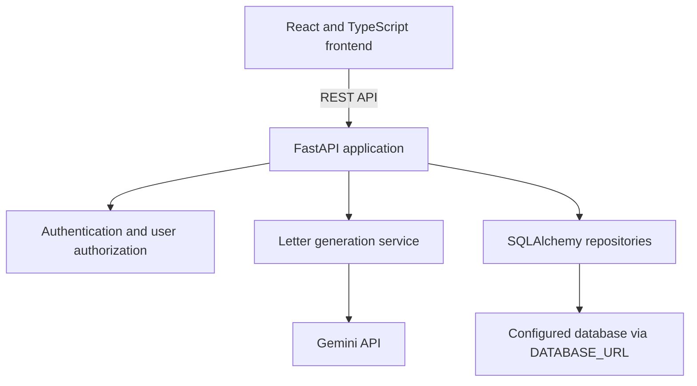

# WriteWise AI

WriteWise AI is a full-stack AI-assisted writing application for generating professional letters from structured user inputs such as recipient, purpose, tone, and context. The project includes a React/TypeScript frontend, a FastAPI backend, Gemini integration, user authentication, and database-backed letter history.

## Application Links

The following deployment URLs are recorded in the project documentation; they have not been live-tested during this repository review.

- **Frontend:** https://writewise-ai-frontend.onrender.com
- **Backend API:** https://writewise-ai-1.onrender.com
- **API documentation:** https://writewise-ai-1.onrender.com/docs

## Implemented Features

- Generate professional letters using a Gemini-backed service
- Register and authenticate users
- Hash passwords and issue JWT access tokens
- Protect user-specific API operations
- Save generated letters and retrieve a user's letter history
- Retrieve and delete an individual user's saved letters
- Use SQLAlchemy for database access and Alembic for schema migrations
- React/TypeScript frontend with Vite, React Router, Tailwind CSS, and API service modules

## Architecture



The database engine is selected through `DATABASE_URL`. The backend contains SQLite support and a PostgreSQL driver dependency; the exact database used depends on the runtime configuration.

## API

The FastAPI backend mounts a versioned router under `/api/v1`. The route groups include root/health information, authentication, application information, and letters.

The letter routes include:

| Method | Route | Purpose |
|---|---|---|
| POST | `/api/v1/letters/generate` | Generate and save a letter for the authenticated user |
| GET | `/api/v1/letters` | Retrieve the authenticated user's letter history |
| GET | `/api/v1/letters/{letter_id}` | Retrieve one of the authenticated user's letters |
| DELETE | `/api/v1/letters/{letter_id}` | Delete one of the authenticated user's letters |

Additional authentication, root, health, and information routes are defined under `backend/app/api/v1/endpoints/`. Use the running API's OpenAPI documentation for the complete request/response schemas.

## Technology Stack

| Layer | Technologies |
|---|---|
| Frontend | React, TypeScript, Vite, Tailwind CSS |
| Backend | Python, FastAPI, Pydantic, Uvicorn |
| Persistence | SQLAlchemy, Alembic; database selected with `DATABASE_URL` |
| Authentication | JWT, password hashing, protected endpoints |
| LLM | Google Gemini API |
| Frontend tooling | React Router, React Query, Axios, React Hook Form, Zod |
| Deployment references | Render URLs recorded in project documentation |

## Repository Structure

```text
.
├── backend/
│   ├── app/
│   │   ├── ai/                    # Gemini client, prompt builder, response parser
│   │   ├── api/v1/endpoints/      # auth, health, info, letters, root
│   │   ├── auth/                  # JWT, password hashing and dependencies
│   │   ├── core/                  # settings, security, middleware, exceptions, logging
│   │   ├── db/                    # SQLAlchemy base, engine and session
│   │   ├── dependencies/
│   │   ├── models/
│   │   ├── repositories/
│   │   ├── schemas/
│   │   ├── services/
│   │   └── main.py
│   ├── alembic/                   # migration environment and versions
│   ├── requirements.txt
│   ├── alembic.ini
│   ├── .env.example
│   ├── test_ai_service.py
│   ├── test_llm.py
│   ├── test_prompt.py
│   └── tests/
├── docs/                          # scope, architecture, API, database and roadmap docs
├── frontend/
│   ├── src/
│   │   ├── components/
│   │   ├── hooks/
│   │   ├── layouts/
│   │   ├── pages/
│   │   ├── services/
│   │   └── types/
│   └── package.json
├── pngs/                          # application screenshots
└── README.md
```

The repository also contains a committed local SQLite database and a `backend/deploy-test/` virtual-environment tree. These are repository hygiene concerns; they have been left untouched.

## Local Development

### Backend

From the repository root:

```bash
cd backend
python -m venv .venv
source .venv/bin/activate  # Windows: .venv\\Scripts\\activate
pip install -r requirements.txt
```

The committed `backend/.env.example` currently contains only `APP_ENV=development`. The application settings also require `DATABASE_URL` and `JWT_SECRET_KEY`; configure those, plus `GEMINI_API_KEY`, in a local `.env` file. Never use real production secrets in a public file.

Run the Alembic migrations from the `backend/` directory:

```bash
alembic upgrade head
```

Start the API:

```bash
uvicorn app.main:app --reload
```

The API's Swagger UI is available at `http://127.0.0.1:8000/docs` by default.

### Frontend

In a second terminal, from the repository root:

```bash
cd frontend
npm install
npm run dev
```

The frontend's `package.json` also defines `build`, `lint`, and `preview` scripts.

## Security and Operational Notes

- Keep API keys, database URLs, and JWT secrets in environment variables or the hosting provider's secret store.
- Use a strong JWT signing key and production-appropriate settings.
- Confirm user-level authorization for every record operation.
- Generated letters should be reviewed before use, particularly for legal, financial, employment, or other consequential communications.

## Validation Status and Limitations

- The source tree and endpoint definitions were inspected; the application was not started and external deployment URLs were not tested.
- The `.env.example` file is incomplete relative to the required settings.
- The tracked local SQLite database and virtual-environment directory should be reviewed before future public releases.
- The repository contains test scripts, but they were not executed in this review.
- The deployed database provider cannot be established from the source files alone.

---

**Sai Datta Putta**

[LinkedIn](https://www.linkedin.com/in/sai-datta-putta/)
